# Diagrams and result visuals

Updated October 12, 2026. This is the checklist of visuals we need, with draft diagrams to review. Mermaid diagrams below can be displayed by Markdown viewers that support Mermaid. They are editable designs, not pictures of an implemented application.

**General** means a reusable process using a chosen list of weaknesses. **Specific** means our actual targets, tools, prompts, cases, and settings. A general design does not mean we have tested all vulnerabilities. A process diagram is different from a deployment diagram showing actual services and connections.

The exact tools, two targets, prompts, cases, and results are still open. Replace placeholders before calling a diagram the final study design. Detailed experiment records accompany the diagrams rather than being squeezed into one unreadable picture.

## Full checklist

| ID | Visual we need | Status and next work |
| --- | --- | --- |
| D01 | General scanner-based app workflow, including final LLM suggestions | Draft below; professor review needed. |
| D02 | Scanner-based app workflow for our two targets | Draft below; fill in targets, scanner, rules, and recommendation model. |
| D03 | General LLM-based app workflow, including final LLM suggestions | Draft below; professor review needed. |
| D04 | LLM-based app workflow for our two targets | Draft below; fill in targets, model, and prompt versions. |
| D05 | General evaluation study design | Draft below; finalize scope, scoring, and run rules. |
| D06 | Our actual three-versus-three study design | Draft below with six slots; replace slots with exact choices and link the records. |
| D07 | CWE weakness-selection method | Draft below; finalize target and relationship criteria. |
| D08 | LLM-01 detection procedure | Required after selection; use the detector template with actual inputs and settings. |
| D09 | LLM-02 detection procedure | Required after selection; record its actual prompt and procedure. |
| D10 | LLM-03 detection procedure | Required after selection; record its actual prompt and procedure. |
| D11 | SCANNER-01 detection procedure | Required after selection; show setup, command, rules, and report handling. |
| D12 | SCANNER-02 detection procedure | Required after selection; show its own setup and limits. |
| D13 | SCANNER-03 detection procedure | Required after selection; show its own setup and limits. |
| D14 | Confusion matrix and nine-pairing organization | Draft layout below; numbers wait for runs and agreed scoring. |
| D15 | Application findings-report method | Draft below; settle grading labels versus user-facing findings. |
| D16 | CWE-supported suggestion method | Draft below; decide retrieval, model, and validation. |
| D17 | Application-controlled versus agent-controlled retrieval | Draft below; implementation choice remains open. |
| D18 | Decision after the comparison | Draft below; agree evidence and time criteria. |
| D19 | Actual application architecture and deployment | Conditional on development; decide local versus deployed operation and components. |

The professor's six methods are covered by D07 (selection), D03/D04 and D08–D10 (LLM detection), D01/D02 and D11–D13 (scanner detection), D05/D06/D14 (comparison), D15 (findings report), and D16 (suggestions). Each needs a written procedure as well. These requirements come from the transcript, especially 17:35–23:07.

## D01: general scanner-based app workflow

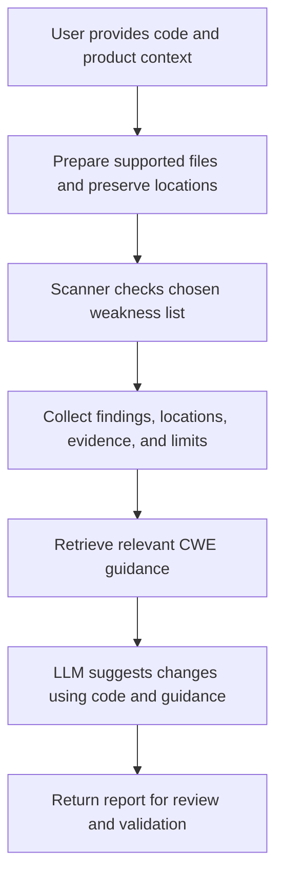

## D02: scanner-based app workflow for our two targets

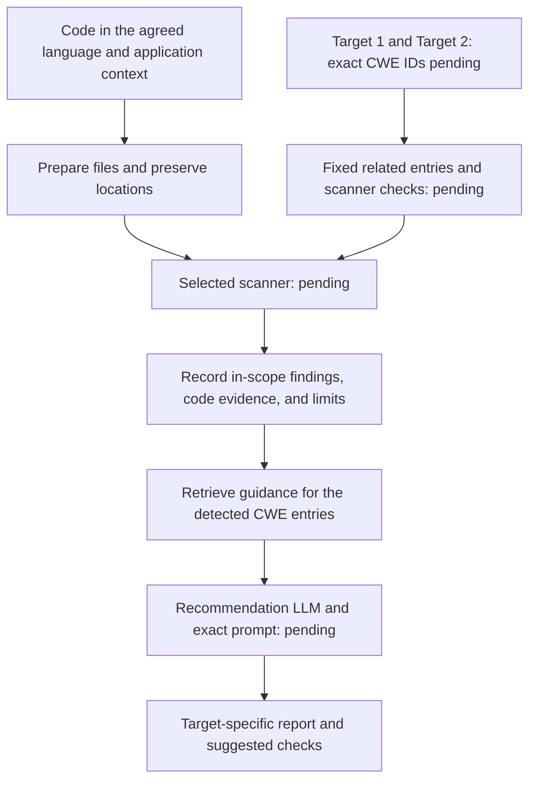

## D03: general LLM-based app workflow

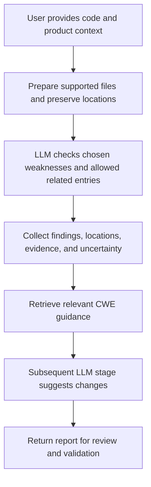

## D04: LLM-based app workflow for our two targets

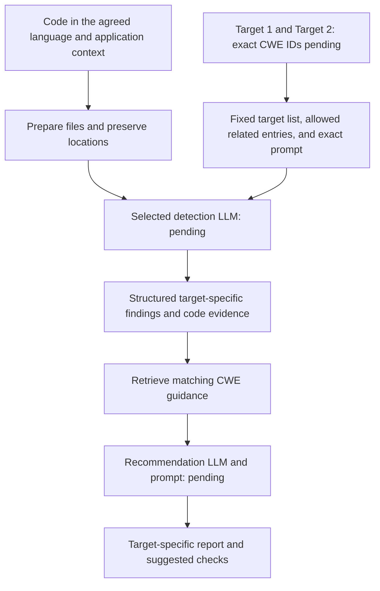

D02 and D04 must name the actual targets later. They must not replace pending IDs with broad OWASP category names and then claim two individual weaknesses were finalized. General and specific detection prompts need separate records if their wording differs.

## D05: general evaluation study

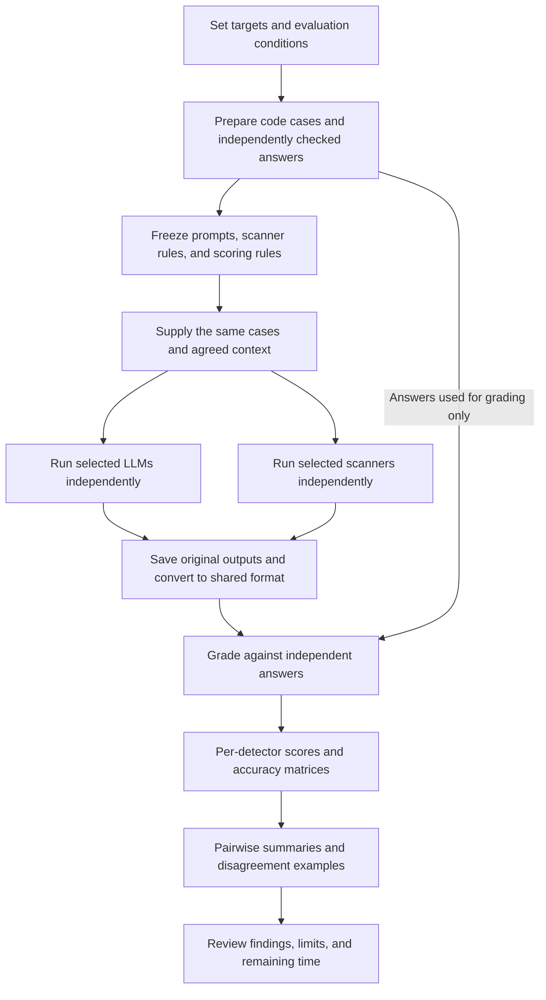

Keep answer records out of the inputs supplied to detectors. Scanner outputs may inspire a reporting format, but their answers for the scored case must not be supplied to the detection LLM.

## D06: our three-versus-three study

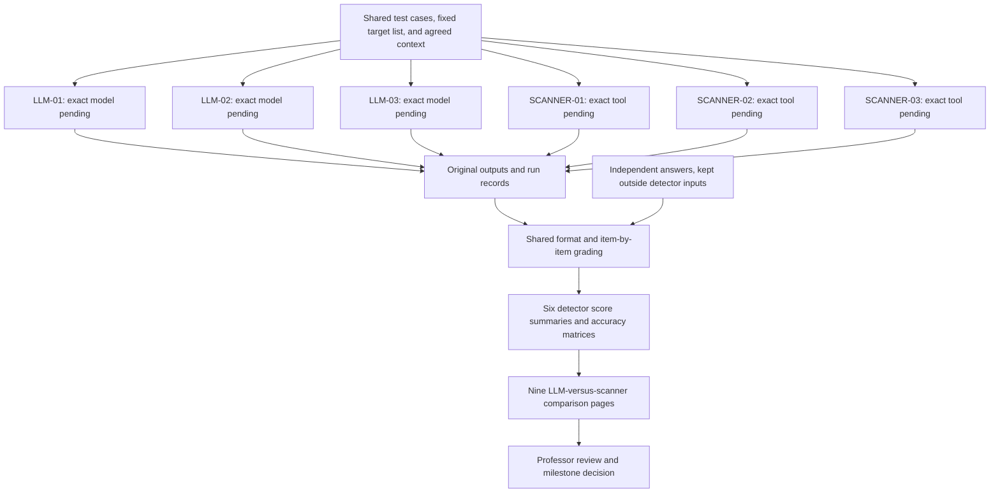

Attach [exact experiment records](experiment-records/README.md) for each slot: model or tool version, prompt or command, configuration, case files, independent answers, original results, and grading. D06 becomes the specific study diagram once these details are filled in.

## D07: selecting targets from CWE

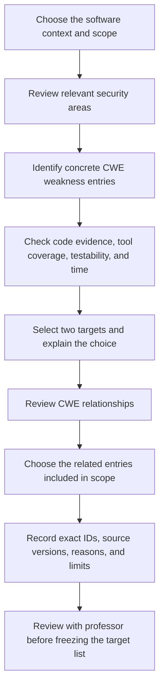

If AI assists selection, record its prompt and output and check proposed entries against CWE. The AI response alone does not establish the target list.

## D08–D13: template for each of the six detector diagrams

Create six separate named diagrams after choosing the models and scanners. They may be similar, but each must show that detector's actual procedure rather than only replacing a title.

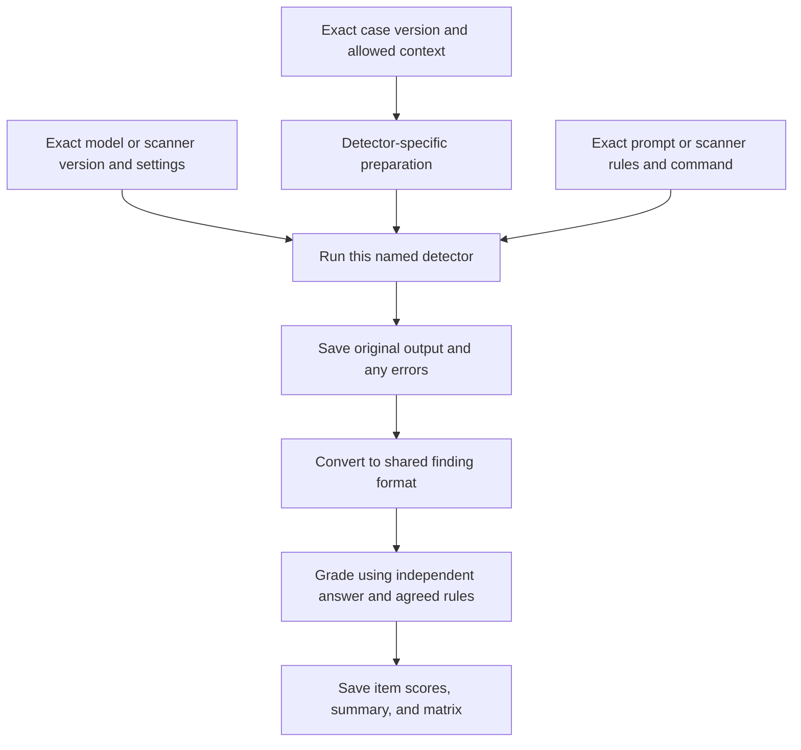

For LLM diagrams, show code selection, message order, prompt version, allowed CWE context, and repeated-run procedure. For scanner diagrams, show setup requirements, supported language, rule selection, exact invocation, and report conversion. Both show how errors and unsupported items are recorded. No experiment results belong in these designs until runs exist.

## D14: organizing matrices and comparison pages

Start with six score summaries, each with its own accuracy matrix against the independent answers: LLM-01, LLM-02, LLM-03, SCANNER-01, SCANNER-02, and SCANNER-03.

Then organize the nine comparison pages in this grid:

| LLM compared with scanner | SCANNER-01 | SCANNER-02 | SCANNER-03 |
| --- | --- | --- | --- |
| LLM-01 | Pair 01 | Pair 02 | Pair 03 |
| LLM-02 | Pair 04 | Pair 05 | Pair 06 |
| LLM-03 | Pair 07 | Pair 08 | Pair 09 |

Each page links the two detector matrices and scores, uses the same scored cases, and shows examples where they differ. Add a direct prediction-agreement table if requested, with that label. Agreement is different from accuracy.

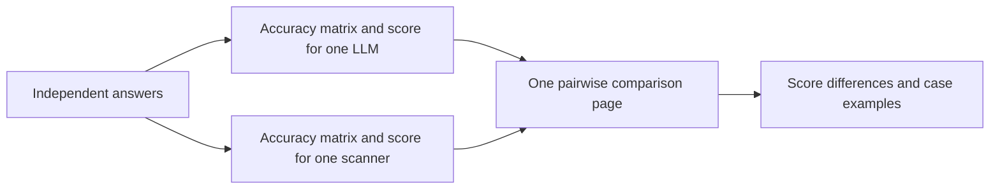

See [the matrix template](experiment-records/templates.md#accuracy-confusion-matrix). Final visuals can include per-target matrices, a six-detector accuracy chart, partial-finding counts, false-alarm and miss summaries, and variation across repeated runs. These depend on agreed rules and actual results. Do not fill blank matrices with zeroes before experiments run.

## D15: organizing the application findings report

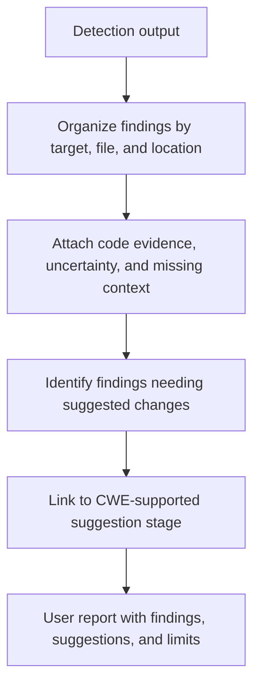

Found, Missing, and Partially Found require reference answers for evaluation grading. A real user upload may not have those answers, so the app cannot claim it knows every missed weakness. Decide separately how the app labels detected, uncertain, and not-detected targets. No finding is not proof that the whole application is safe.

## D16: generating suggestions from CWE guidance

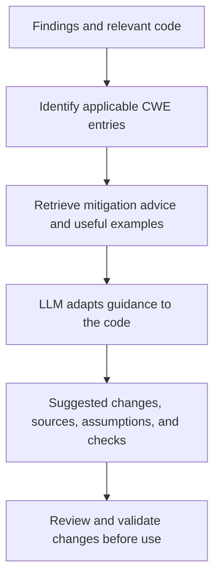

The method needs the exact retrieval procedure and recommendation prompt. CWE guidance is not always a ready-made checklist or patch. Validating generated fixes is later work if development proceeds.

## D17: two retrieval options

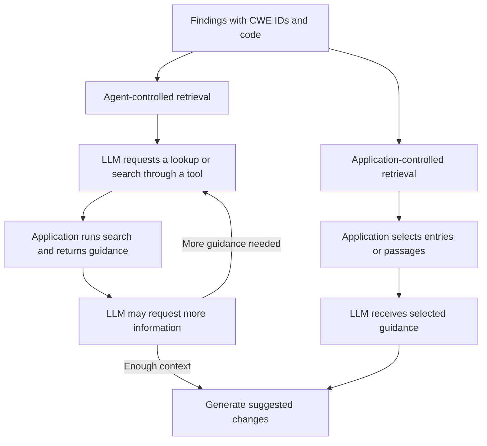

Both options return readable guidance into the model's context. An agent may use several requests; it does not avoid context limits. Decide the option before turning this draft into an actual architecture.

## D18: decision after the comparison

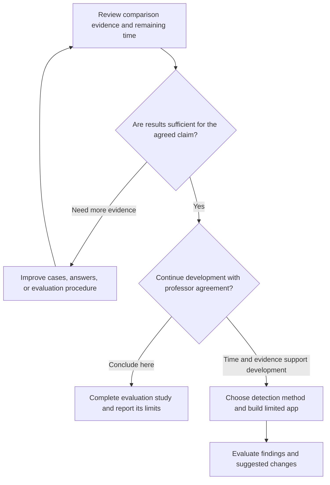

Agree the evidence and time criteria with the professor. Neither a large difference nor a small difference automatically settles the development decision.

## D19: actual architecture, if development proceeds

After the development decision, show the actual input component, chosen detector, code-context collection, CWE storage, retrieval service or agent tools, recommendation model, and report component. Show where each runs and how they connect. Keep a general architecture and a version naming our actual targets and components if useful for review.

Do not label the workflow drafts as a deployed architecture. No hosting platform, database, or model connection has been chosen in these notes.
